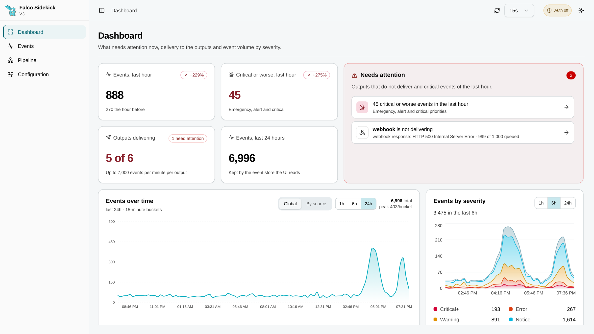
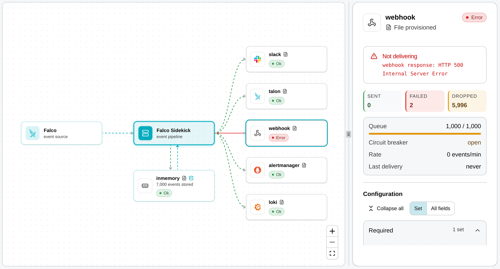
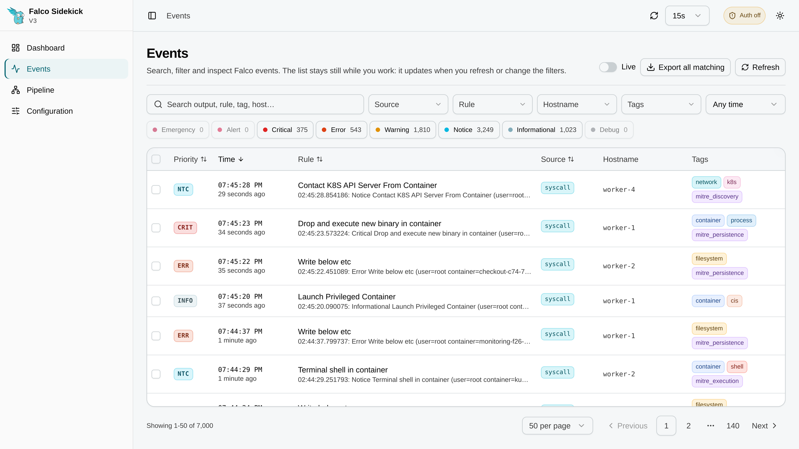

Dear Falco Community, earlier this month at [KubeCon + CloudNativeCon North America](https://events.linuxfoundation.org/kubecon-cloudnativecon-north-america/) in Salt Lake City, we presented Falcosidekick v3 in our Falco Maintainer Track session, [Falco Never Flies Alone: Runtime Security as an Ecosystem](https://events.linuxfoundation.org/kubecon-cloudnativecon-north-america/program/schedule/?id=1289719). On the same day, November 12, we released **Falcosidekick 3.0.0-beta.1**, its first beta. This post tells the whole story.

[Thomas Labarussias](https://github.com/Issif) made the first commit of Falcosidekick in September 2018. Since then, about 140 contributors have added integrations with about 70 tools, from Slack and Teams to Loki, Elasticsearch, Kafka and on-call services.

v3 is a new implementation of the same idea. Falco still sends its events to one place, exactly as before, and Falcosidekick still forwards them to the outputs you configure. What's new is everything in between: a delivery pipeline shared by every output, strict configuration with live reloads of the output files, a built-in web UI, optional persistence, and outputs rewritten against the current API of their destinations.

It's a beta, and v2 configuration doesn't load in v3, so this is a release to test, not to roll out everywhere on a Friday afternoon. We'd love your feedback before 3.0.0.

## What's new? TL;DR

*Key features:*
- [A delivery pipeline per output](#follow-an-event): its own queue, workers, retries with backoff, a circuit breaker and optional batching
- [Protocol-aware retries](#retries-that-know-when-to-stop) that stop on permanent rejections
- [Draining queues on shutdown](#draining-queues-on-shutdown), after Kubernetes stops sending traffic
- [Strict configuration, reloaded live](#configuration): a core file and output files, unknown keys rejected, output files reloaded on change
- [Credentials from files](#credentials), kept out of API responses and logs
- [A built-in web UI](#a-built-in-web-ui): dashboard, pipeline, events and configuration
- [Persistence and replicas](#outputs-from-the-ui-and-several-replicas): outputs created from the UI kept in sqlite or postgres, and shared between replicas
- [Outputs rewritten](#outputs), each with its own documentation page and tested versions

*Key changes for v2 users:*
- New configuration format and key names
- New metric names
- Distroless image running as `65532`, new probes (`/livez`, `/readyz`) and image tags (`3.*`, `v3-main`)
- 24 outputs in this beta

{}
v2 configuration doesn't load in v3. Before trying it, read the [migration guide](https://github.com/falcosecurity/falcosidekick/blob/master/docs/migration.md) and check that your outputs are in the [outputs list](https://github.com/falcosecurity/falcosidekick/blob/master/docs/outputs/README.md). v2 keeps getting fixes on the `2.x` branch, and `latest` still points to it.
{}

## Why v3

v2 grew the way good open source projects grow: one output at a time, each one added by someone who needed it. That's how it reached about 70 integrations, and why so many Falco users rely on it every day.

For v3, we wanted the parts that every output has in common to live in one place: how events are queued, retried and counted, how the configuration is validated and reloaded, how credentials are read. Each output now implements only the protocol of its destination, and everything else comes from a runtime they all share. A fix or an improvement there reaches every output at once.

## Follow an event

Let's follow a single Falco event through v3.


**Ingest.** Falco posts the event on port 2801, as it always has. Falcosidekick checks that it's valid JSON with the fields it needs, and answers right away. An invalid payload gets an HTTP 400 and is counted in `falcosidekick_ingest_requests_total{status="invalid"}`.

**Enrich.** Custom fields, templated fields and tags from the `enricher` section of the core file are added once, before the event reaches any output.

**Fan out.** The event is copied to every output whose `minimum_priority` it meets. Each output has its own bounded queue: if Elasticsearch slows down, its queue fills up and Slack keeps delivering. When a queue is full, new events for that output are dropped and counted.

**Deliver.** The output's workers take events from the queue, one at a time or in batches, and send them. The metrics, the API and the UI report sent, failed and dropped events for every output, with its queue depth and circuit state, and Prometheus also records how long each delivery attempt takes.

### Retries that know when to stop

When a delivery fails, the output looks at why. Transient failures, like a network error, a timeout or a destination that's overloaded, are retried with capped exponential backoff, within `retry.max_attempts`. A rejection that won't change on the next attempt ends the delivery at once: for a plain HTTP output, that's a 400, 401, 403 or 404.

Each output follows the rules of its own protocol. Kafka errors marked as non-retriable, SMTP `5yz` replies, Redis `WRONGPASS`, AWS throttling answers and OTLP status codes are handled the way those services define them, and each output page describes its rules. The last delivery error shows up in the API and the UI.

When only part of a batch is rejected, Elasticsearch and Policy Reports retry only the events that can still be delivered.

### When a destination goes away

After repeated transient failures, the output's circuit breaker opens and pauses delivery for a while, instead of piling up requests. Then it lets one attempt through at a time, and resumes normal delivery after `success_threshold` successes (2 by default). Meanwhile the API and the UI show the open circuit and the last error.

Most outputs also probe their destination when they're built, at startup or after a configuration change. If the probe fails, because the host is unreachable, a topic is missing or the credentials are wrong, the output starts as `degraded` with the reason, the others start normally, and it begins delivering as soon as its destination accepts events. Some outputs, like Slack and Webhook, can't be checked without sending something, so their errors show up on the first delivery.

### Draining queues on shutdown

On `SIGTERM`, `/readyz` starts failing so that Kubernetes stops sending new traffic to the pod, while Falcosidekick keeps accepting events for `shutdown_delay` (5 seconds by default). Then it closes its listeners and drains the output queues, within a 10-second deadline. Events still waiting when that deadline expires are not delivered.

## What else is new

### Configuration

v3 splits the configuration in two:

- a **core file** (`-c sidekick.yaml`) for the service itself: listener, logging, metrics, enrichment, UI, API, database, and the runtime defaults of every output;
- one or more **output files** (`-o outputs.yaml`, repeatable) for where events go. An output is enabled when its block is there.

```yaml
outputs:
  slack:
    secret_endpoint_file: /etc/falcosidekick/secrets/slack/webhook-path
    runtime:
      minimum_priority: warning
  loki:
    host: http://loki.monitoring:3100
    runtime:
      batching:
        enabled: true
```

Keys are snake_case, values are typed and checked against their allowed range, and unknown keys are rejected: a typo stops the process at startup with the reason in the log, and on a reload the change is refused while the running outputs carry on.

Output files are reloaded when they change, on `SIGHUP`, or by polling, and all three go through the same path: new and changed outputs are built first, then switched all at once, while the outputs that didn't change keep running. In Kubernetes, editing the ConfigMap is enough. Changes to the core file still need a restart.

### Credentials

Several services put the credential in the URL itself: Slack, Discord, Teams workflows and Grafana OnCall webhooks all work that way. v3 splits HTTP addresses into a public part, `host`, `base_path` and `endpoint`, and a secret one, `secret_endpoint` or secret query parameters. Headers can be secret too.

Every secret field has a `_file` variant, so it can come from a mounted Kubernetes Secret, and a change to that file reloads the output. Secret values are never returned by the API or written to the logs.

### A built-in web UI

[Falcosidekick UI](https://github.com/falcosecurity/falcosidekick-ui) has been the companion of Falcosidekick for years, with Redis to store the events. v3 brings a UI into Falcosidekick itself: the recent events it shows come from an `inmemory` output, so there's nothing else to deploy to see them.



The dashboard starts from what needs your attention now: the outputs that aren't delivering and the critical events of the last hour. Below, the event volume over time, by source and by severity.



The pipeline page draws Falco, Falcosidekick and every output with its status. Click an output for the details: events sent, failed and dropped, how full its queue is, the state of its circuit breaker, its last delivery and last error, and its settings.



The events page searches and filters recent events by priority, rule, source, hostname and tags, and exports the matching ones. The configuration page shows the running configuration, with every secret masked.

The UI and the API run on a separate management port, `2802`, which listens on `127.0.0.1` by default: the API has no authentication yet, so you have to open it on purpose. The Helm chart turns the UI on; with Docker, the [install guide](https://github.com/falcosecurity/falcosidekick/blob/master/docs/install.md#web-ui) shows how.

### Outputs from the UI, and several replicas

The API is read-only by default. With `api.allow_writes: true`, you can create, edit and remove outputs from the UI, with a form built from each output's schema and the same validation as the files. The outputs defined in your files stay read-only, unless you set `provisioning.allow_ui_updates`. Even then, Falcosidekick never writes your files: a change from the UI lasts until the next restart or reload of the output files, which puts the file version back.

By default, outputs created from the UI live in memory. With `database.backend` set to `sqlite` or `postgres`, they're kept across restarts, together with the UI layout. Secret values are never written to the database: there, a secret has to be a file path. With postgres, several replicas share the same outputs: a change made on one reaches the others through database notifications, with periodic polling as a fallback. The outputs from your files don't need any of this: every replica reads the same files. The recent events the UI shows are per replica.

### Outputs

Each output was rewritten for v3 against the current API of its destination, with its own documentation page, generated from the same schema the code and the UI use, and with the versions we test it against. Some behaviors changed along the way; these are the ones you're most likely to notice:

- **PagerDuty**: the severity follows the Falco priority, the event details are included, and `region: eu` sends to the EU host.
- **Opsgenie**: the event UUID is the alert alias, so a retried event updates the same alert.
- **Elasticsearch and OpenSearch**: documents use the event UUID as their id, so a retry doesn't write a duplicate in the same index, and bulk responses are checked item by item.
- **Kafka**: every attempt is bounded by `producer.delivery_timeout`, with SASL and TLS.
- **Teams**: Adaptive Cards on Workflows webhooks.
- **Syslog**: RFC 5424, with octet counting on TCP, and TLS.
- **SMTP**: STARTTLS is required by default, and credentials are never sent in clear text to a remote server.
- **Datadog**: the API key travels in a header.
- **Policy Reports**: reports follow the [OpenReports](https://openreports.io) API.
- **OTLP**: logs and metrics, over gRPC or HTTP.

The 24 outputs of this beta cover chat (Slack, Teams, Discord), alerting and on-call (Alertmanager, PagerDuty, Opsgenie, Grafana OnCall, Datadog), logs (Loki, Elasticsearch, Syslog), queues and streams (Kafka, SQS, SNS, Pub/Sub), storage (S3, Redis), OpenTelemetry, email, webhooks and CloudEvents, Falco Talon and Policy Reports. The [outputs index](https://github.com/falcosecurity/falcosidekick/blob/master/docs/outputs/README.md) has a page for each.

### Metrics

Metrics are exposed for Prometheus on `/metrics`, with new names: `falcosidekick_events_total`, `falcosidekick_output_events_total{output,status}`, `falcosidekick_ingest_requests_total`, and per output the queue length, dropped events, circuit state and request duration.

Event metrics carry the `rule`, `priority` and `source` labels, and `metrics.extra_labels` adds the output fields you choose. Rule, source and extra label values are capped per label: after `metrics.max_label_values` distinct values, new ones are recorded as `other`. The [migration guide](https://github.com/falcosecurity/falcosidekick/blob/master/docs/migration.md#metrics) maps the v2 names to the new ones.

### Images and chart

- **Distroless image**, running as user and group `65532`, with no shell. The `-slim` variant leaves the UI out.
- **IPv4 and IPv6**, `/livez` and `/readyz` probes, JSON logs.
- **Signed**: release and `master` images are signed with cosign, keyless, and releases carry SLSA provenance.
- **A chart that lives with the code**: the v3 Helm chart is maintained in the [Falcosidekick repository](https://github.com/falcosecurity/falcosidekick/tree/master/chart/falcosidekick) and synced to the Falco charts repository, so the code and the chart can change in the same pull request.

## How we tested it

Every pull request to v3 runs the unit tests with the race detector, the UI tests, the linters, `govulncheck`, and an end-to-end suite. Most outputs are tested against the real server in a container: Kafka 3.9 and 4.4, Elasticsearch 7, 8 and 9, OpenSearch 2 and 3, Loki 2.9 and 3.7, two Alertmanager versions, Redis 7.4 and 8, postgres 17 and 18, the OpenTelemetry Collector, and Policy Reports on a kind cluster. AWS runs against LocalStack, Pub/Sub against its emulator, SMTP against Mailpit, and the SaaS outputs like Slack against test servers that check the exact requests. A release isn't published unless all of it passes.

## Before you migrate

Before installing v3, check the configuration changes, the supported outputs and how you'll reach the management port:

- **24 outputs.** If yours is missing, stay on v2 and [open an issue](https://github.com/falcosecurity/falcosidekick/issues), so we know what to add next.
- **Configuration, metrics, probes, image tags and the container user changed.** The [migration guide](https://github.com/falcosecurity/falcosidekick/blob/master/docs/migration.md) covers each of them.
- **The Falco chart and the Falco Operator still deploy v2.** Install the v3 chart on its own for now.
- **The management API has no authentication.** Keep port 2802 private.

The rest is in [known limits](https://github.com/falcosecurity/falcosidekick/blob/master/docs/known-limits.md).

v2 now lives on the [`2.x`](https://github.com/falcosecurity/falcosidekick/tree/2.x) branch and keeps getting security and critical fixes. The `latest` and `2.*` image tags still point to v2, and `helm install` without `--devel` still installs the `0.x` chart, so nothing changes until you decide to move. One thing does change: v2 images are now published to Docker Hub only, so if you pull them from `public.ecr.aws`, switch to `docker.io/falcosecurity/falcosidekick`.

## Try it

The v3 chart is a pre-release, so Helm only picks it with `--devel`:

```shell
helm repo add falcosecurity https://falcosecurity.github.io/charts
helm repo update
helm install falcosidekick falcosecurity/falcosidekick --devel \
  --namespace falco --create-namespace \
  --set outputs.webhook.host=http://receiver.example:8080
```

Or with Docker:

```shell
docker run -d -p 2801:2801 \
  -v "$PWD/outputs.yaml:/etc/falcosidekick/outputs.yaml:ro" \
  falcosecurity/falcosidekick:3.0.0-beta.1 \
  -o /etc/falcosidekick/outputs.yaml
```

Then point Falco to it, as before:

```yaml
json_output: true
http_output:
  enabled: true
  url: "http://falcosidekick:2801/"
```

The [install guide](https://github.com/falcosecurity/falcosidekick/blob/master/docs/install.md) covers Kubernetes manifests, the web UI, persistence and image verification.

## Conclusion

You can find the full changelog [here](https://github.com/falcosecurity/falcosidekick/releases/tag/v3.0.0-beta.1).

Please test it with the outputs you use and the events your Falco really sends, and tell us what you find, in an [issue](https://github.com/falcosecurity/falcosidekick/issues) or on the `#falco` channel. Configuration that doesn't load, an output that misbehaves, a metric you miss: all of it helps shape 3.0.0.

And thanks to everyone who has built, fixed and run Falcosidekick since 2018.

---
* Get started in [Falco.org](http://falco.org/)
* Check out the [Falcosidekick project on GitHub](https://github.com/falcosecurity/falcosidekick).
* Get involved in the [Falco community](https://falco.org/community/).
* Meet the maintainers on the [Falco Slack](https://kubernetes.slack.com/?redir=%2Farchives%2FCMWH3EH32).
* Follow [@falco_org on Twitter](https://twitter.com/falco_org).
